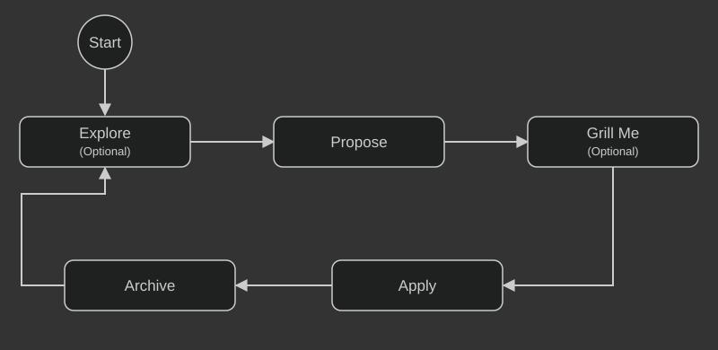

# OpenSpec Commands

Use OpenSpec to agree on a focused change before implementation, then keep its specifications aligned with the completed work.

## Table of Contents

1. [Getting Started](#getting-started)
2. [Details](#details)
3. [Command List](#command-list)
4. [Resources](#resources)

## Getting Started

Use this suggested flow for one focused change. It is guidance, not a required
gate.

### 1. Plan

**Prompt AI:**

```
$ai-skills-openspec-propose
```

Optionally use `$ai-skills-openspec-explore` or `$ai-skills-openspec-grill-me` first. Then create
the proposal, specifications, design, and tasks for the change.

### 2. Apply

**Prompt AI:**

```
$ai-skills-openspec-apply-change
```

Implement the approved change and complete its tasks.

### 3. Finalize

**Prompt AI:**

```
$ai-skills-openspec-sync-specs
```

Sync accepted delta specifications, archive the completed change, then use
`$ai-skills-openspec-commit-inclusive` to commit and push the scoped work. The
finalization macro combines those close-out steps when appropriate.

## Details

Here are more commands to try.

## Command List

<p align="center">
  
</p>

Here are commands and the recommended AI intelligence level to use.

| # | Command | Purpose | Rec. Intelligence |
| --- | --- | --- | --- |
| 1 | `$ai-skills-openspec-dashboard` | Inspect the local dashboard at any stage. |  |
| 2 | `$ai-skills-openspec-explore` | Brainstorm or investigate a possible change without implementation. |  |
| 3 | `$ai-skills-openspec-grill-me {n}` | Settle planning decisions with focused questions. |  |
| 4 | `$ai-skills-openspec-propose` | Create one focused change proposal. |  |
| 5 | `$ai-skills-openspec-update-change` | Revise planning artifacts as decisions evolve. |  |
| 6 | `$ai-skills-openspec-apply-change` | Implement the current change. |  |
| 7 | `$ai-skills-openspec-sync-specs` | Apply accepted delta specifications to the main specifications. |  |
| 8 | `$ai-skills-openspec-archive-change` | Finalize and archive a completed change. |  |
| 9 | `$ai-skills-openspec-commit-inclusive` | Commit and push files related to one archived change. |  |
| 10 | `$ai-skills-openspec-macro-finalize-sync-archive-commit-push` | Run the full close-out sequence after implementation. |  |

For a repository version release after a remote commit exists, use
[`$ai-skills-create-github-release`](../.agents/skills/ai-skills-create/ai-skills-create-github-release/SKILL.md).

### Proposal Artifacts

With the default spec-driven schema, `$ai-skills-openspec-propose` creates these files inside
`openspec/changes/<change-name>/`. Other schemas may use different artifacts.

| File | Purpose | Answers? |
| --- | --- | --- |
| `proposal.md` | Defines the problem, goals, and scope. |  |
| `specs/<capability-path>/spec.md` | Defines requirements and scenarios. |  |
| `design.md` | Records the technical approach and key decisions. |  |
| `tasks.md` | Tracks implementation work. |  |

## Resources

- [OpenSpec documentation](https://openspec.dev/docs)
- [OpenSpec on GitHub](https://github.com/Fission-AI/OpenSpec)
